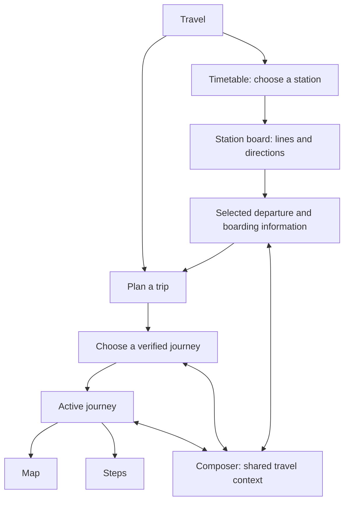

# GVB study → Expadu Travel decisions

Research date: **4 October 2026**. Status: **research complete within public-source and browser access; recommendations, not approved implementation**.

## Recommendation

Make Travel answer four questions in order: **Where should I go? Which service should I take? Where do I board? What happens next?** The current station board is a useful foundation. Its weakest points are stop discovery, boarding-place certainty and continuity between choosing a service and planning a journey.

Retain Expadu’s accepted palette, compact top navigation, side-by-side desktop planner, equal departure rows and existing Map/Steps journey views. The next iteration should improve those flows rather than introduce another visual concept. Composer should understand the same selected journey and its uncertainty while ordinary travel actions remain directly usable.

## What was actually verified

| Evidence | Scope and limitation |
| --- | --- |
| Current public releases | iOS listing: **2.27.2, “7 Sep”**; 2026 is inferred from surrounding history. Android listing: **updated 4 September 2026**. These are store observations on the research date, not an installed-build check. |
| Official GVB guidance and supplier cases | Documented features and publicly described technology. Undated pages can lag releases; several guides were accessible through indexed official text rather than direct retrieval. |
| GVB website, operated in Chrome | Searched for Centraal, selected the Amsterdam tram stop, and inspected stop information and departures. This verifies the **website**, not the native app. |
| Store screenshots, visually inspected | Planner, nearby-stop widget and departures screen. Screenshot capture dates/builds are unknown. They establish a published visual reference only. |
| Expadu, source and browser review | Reviewed the current station prototype and shared journey/Composer code. Exercised line/direction filters and List/Map; inspected mobile at a 390 × 844 viewport. |
| Not verified | Current native GVB interactions, backend contracts, private APIs, location detection, automatic rerouting, refresh cadence or notification delivery. |

Release sources: [iOS](https://apps.apple.com/nl/app/gvb-reis-app/id1544439867), [Android](https://play.google.com/store/apps/details?id=nl.gvb.reizigersapp&hl=en). A concrete freshness warning: current release notes phase out the balance checker, while the undated overview still promotes it. Public documentation is not an exact inventory of a running build.

## Useful GVB patterns—and their limits

The documented product supports nearby and favourite stops, journey planning, vehicle positions and personal disruption preferences. These create short paths for regular travel. A traveller need not re-enter a complete journey merely to check their usual stop. [GVB app guide](https://www.gvb.nl/reisinformatie/gvb-app)

The published departures screenshot groups several line/direction rows beneath stop headings and pairs relative departure time with clock time. This is a useful scanning pattern, but it does not reveal the underlying station/platform schema or confirm today’s installed layout. [GVB’s store screenshots](https://play.google.com/store/apps/details?id=nl.gvb.reizigersapp&hl=en)

On the live website, choosing **Centraal Station / Tram / Amsterdam** opened a specific stop record with line 26 towards IJburg, several departures, facility information and a separate timetable. However, search also exposed two indistinguishable metro suggestions. GVB is a reference to assess critically: Expadu should make same-name stops distinguishable when reliable descriptors exist. [Observed stop page](https://www.gvb.nl/en/travel-information/stop/NL:S:30005029)

GVB reports that Seintje sends relevant incident updates and a resolution notice, with facility faults connected to alternative advice. The useful principle is to explain what changed and what to do, with restrained notifications. This is published behaviour, not a delivery test. [GVB 2025 annual report, pages 32–33](https://over.gvb.nl/content/uploads/2026/05/GVB-Jaarverslag-2025-27-05-26.pdf)

## Findings in our current Travel study

| Priority | Traveller problem | Evidence | Proposed response |
| --- | --- | --- | --- |
| First | “I don’t know the stop’s name.” | The picker searches a limited captured catalogue; no nearby ranking or manual search-area flow. | Add a compact stop chooser with Nearby, Recent and Saved contexts. Allow a manually chosen starting place; request location only when used. |
| First | “Which side do I wait on?” | Sixteen captured Neumarkt services, ten stop records and eight marker groups; departures have no verified point/platform link. | Distinguish station, boarding point and individual departure. Show a precise point only when the provider association is verified; otherwise keep the uncertainty explicit. |
| First | “I picked a service—why did planning forget it?” | Captured departures without an itinerary ID become station/date/time requests. Line, headsign and capture provenance are not uniformly retained downstream. | Carry a reviewable service preference into planning and Composer, including its source and age. A preference must not masquerade as a confirmed itinerary. |
| Next | “Where did the other direction go?” | After choosing Line 1 → Weiden West and closing preferences, the control says only **Filters 2**. | Keep a compact visible summary of the active direction and notice filter, with a clear action. |
| Next | “Where is my departure when I open the map?” | At 390 × 844, the map pushes the first departure time below the initial viewport. Map scope is line-based, even when the list has a direction filter. | Keep the chosen service/time visible in Map view, use a compact map with explicit expansion, and retain selection across views. Explain candidate-location scope until data permits exact matching. |
| Next | “Can I take this trip again today?” | Saved journeys reopen dated sample itineraries. They are not recurring-trip shortcuts. | Separate historical journeys from saved stops and repeat trips. Repeating a trip requests fresh routes and times. |

The board already preserves simultaneous departures, selected station during type changes, honest sample labels and shared Map/Steps progress. Keep these strengths. The [source audit](./expadu-audit.md) contains implementation references and dependencies; earlier application/staging checks are identified there as prior evidence, not rerun during this study.

Mobile evidence: [List](./expadu-mobile-list.png) · [Map](./expadu-mobile-map.png). Both show the same Line 1 / Weiden West selection. Browser filters and viewport were restored afterwards.

## Proposed interaction structure

This is an **Expadu proposal**, not a reconstruction of GVB’s exact tab hierarchy. Keep Plan a trip and Timetable as the two Travel entries. Nearby, Recent and Saved belong inside the compact stop chooser, rather than becoming more top-level tabs.

**Desktop:** preserve the side-by-side approach. Keep the board readable beside a map or selected departure detail; selection connects the two. Extra width should reveal useful geography and context rather than an oversized featured departure.

**Mobile:** useful departures lead in List view. Map view must retain the selected service summary and provide an immediate return to the same list position. Optional preferences stay collapsed, but active choices remain visible. Sheets preserve focus and selection; short transitions respect reduced motion. Do not animate markers or countdowns to imply data updates.

**Active travel:** preserve Map and Steps as two views of one journey. Both need the current leg, next action, transfer/get-off information and relevant disruption. A moving vehicle, the user’s device position, a predicted departure and manually advanced progress are different facts. Label each honestly. Current GVB map-free tracking has not been verified; retaining and improving Expadu’s existing Steps view is our recommendation.

## Architecture implications

The supplier’s public case describes React Native, Azure Application Gateway, .NET microservices and Contentful. It does not expose current service boundaries, versions or APIs. There is no evidence-based reason here to replace Expadu’s existing stack. [Infi’s GVB case](https://infi.nl/case/gvb/)

For Expadu, define shared travel records around:

- **Place → station area → boarding point:** retain city/network/provider identity and distinguish known relationships from inferred candidates.
- **Line + direction + individual service:** headsign text and line number alone cannot identify a particular trip or platform.
- **Time and evidence:** separate requested time, schedule, prediction and captured approximation. Carry source, observation time and unavailable/stale status into every handoff.
- **Journey context:** origin, destination, preferences, selected service, verified itinerary, active leg and chosen view. Editing an incompatible origin/time should visibly invalidate the old selection.
- **Capabilities:** exact boarding point, vehicle location, accessible approach, incident coverage and route refresh depend on provider data. UI should expose supported capabilities and truthful fallbacks.

Composer consumes this shared context and proposes relevant actions. It must not independently invent a platform, translate old captured times into live recommendations or silently replace the selected itinerary. Saving a favourite stop does not subscribe to notifications; those require a separate deliberate choice.

## Recommended delivery order

1. **Small prototype improvement:** visible active direction; persistent selected service in Map/List; compact mobile map; explicit service-context and estimate labels in handoffs. Preserve the accepted shell and colours.
2. **Discovery study:** nearby/manual origin and distinct saved-stop/repeat-trip flows. Use representative sample cases clearly labelled; do not manufacture walking times or boarding assignments.
3. **Data integration:** validate station grouping, departure-to-point association, provider trip identity, freshness, cancellations and supported travel capabilities against the actual environment.
4. **Live journey and alerts:** connect real feeds to the existing Map/Steps session, then add useful incident updates and recovery. Implement notification subscriptions only when reliable incident scope and lifecycle exist.

Keep GVB’s ticket shop, menu customization and ferry-specific features outside this Travel iteration. Accessibility options need actual suitability data; an attractive toggle cannot establish a step-free journey. Avoid adding widgets simply to fill desktop space.

## Acceptance tasks and remaining native study

The next Expadu review should demonstrate:

1. Find a station without knowing its name; complete the same task with location denied.
2. Compare simultaneous departures and both directions of one line without losing station context.
3. Explain the boarding place—or clearly see that it is unknown—without relying on colour or a map alone.
4. Switch List → Map → List with the selected service, filters and scroll position intact; keep its departure time visible on mobile.
5. Send a service to Composer with its age and uncertainty preserved; then change time and see incompatible context reconsidered.
6. Resume a journey in Map or Steps; recover from unavailable maps/data without pretending progress is live.
7. Reopen a saved historical journey and separately request a fresh repeat trip.

A native GVB session is still needed to verify exact screen transitions, same-name stop grouping, vehicle tracking without a map, GPS denial, offline behaviour, favourite persistence, larger text/VoiceOver and notification recovery. Public sources cannot establish those outcomes or physical wayfinding accuracy.

Supporting research: [documented flows](./flow-evidence.md), [technical evidence and unknowns](./technical-evidence.md), [Expadu code audit](./expadu-audit.md). **No application or prototype source files were changed during this study.**
