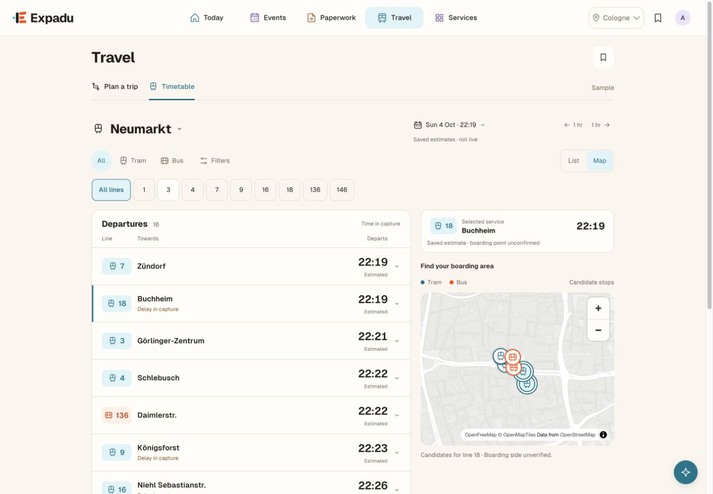
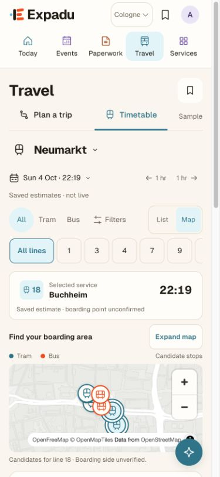
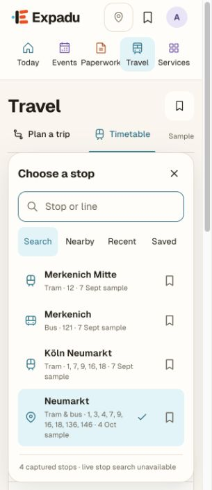

# Travel refinement — 4 October 2026

Applied the approved follow-up to the GVB study in the separate station preview:
`http://127.0.0.1:8765/dev/design/departures-next/station.html?view=timetable`.
The approved Travel palette, shared header and equally weighted timetable remain.
This is prototype work, not a deployment or a Laravel/React implementation.

## Changes

- Stop discovery separates Search, Nearby, Recent and Saved. Search understands
  accents and recorded line numbers; recents and saves reflect actual choices.
  A manual sample area works without GPS. Location is only requested on tap.
- Active directions and service notices remain visible when filters close.
- List/Map retains the selected departure, candidate stop and each view's scroll
  position. The phone map starts compact, with a selected/first matching departure
  visible above it, and expands on request. Desktop retains the side-by-side board.
- Selected service context goes into the journey request and Composer: line,
  headsign, approximate departure, source/capture time and unknown boarding point.
  Review journey restores that preference. Changed origin, time or mode clears
  incompatible service context rather than silently using it.
- Saved journeys offer “Plan this trip again”, starting a fresh request with the
  current date/time and the original endpoints, not replaying the old itinerary.

## Review and verification

366 focused Node tests passed across the Travel, connected handoff, Composer and
stop-discovery suites. Prettier checks passed for changed implementation files.
Changed script/style references have content hashes so refreshed previews request
the matching assets. Static served files were checked against the workspace.

Chrome checks at 1440 × 1000, 390 × 844 and 320 × 740 covered:

- stop saving/unsaving, manual Nearby and stop selection;
- line/direction filters, closing filters and independently clearing direction;
- selecting a departure, candidate map point, List/Map return, expanding/collapsing
  the map and mobile departure details;
- departure → planner → Composer → Review journey, with the selected service and
  capture warning visible on return;
- switching to Walk clears a transit preference; repeat-trip starts a fresh request;
- narrow-phone overflow/focus styling and repeated page refreshes;
- no browser console errors in the final checked Travel session.

Integration review found and fixed pagination clearing a still-valid selection,
mobile rows not immediately highlighting their selection, stale map highlighting
after a filter excludes the selected service, stale planner notices, and Composer
defaults overriding a restored service's mode/origin.

## Data boundaries

The chooser has four captured stop records, only one with coordinates. Nearby
states that coverage and labels straight-line distance. It is not live stop search.
Neumarkt uses the existing 4 October 22:19 capture; its rounded countdowns are
estimates, not a live clock. Map points are candidate locations, not assigned
platforms. The earlier journey Map/Steps previews remain manually advanced.
Fresh routing, live vehicle/GPS updates and exact boarding assignments are not
connected. Composer retains a service preference, not a confirmed itinerary.

The separate September journey examples remain explicitly labelled as sample
routes; they must not be interpreted as matches for an October service preference.

## Screenshots

