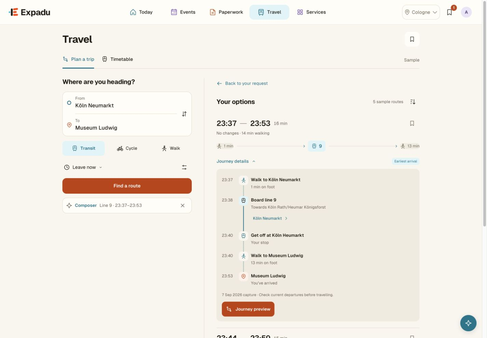
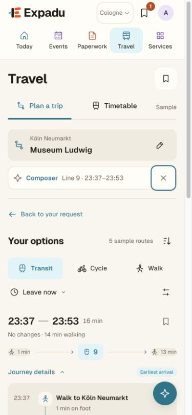

# Travel: compact Composer help

5 October 2026. Applies to the local Travel prototype, including `station.html`.

Route cards lead with Journey preview and Save. The journey preview retains
Map, Steps, Save and Start preview; repeated Composer buttons were removed from
the cards, details and preview. One small helper beside the planner provides
optional contextual help. It remains reachable when the mobile form collapses.

The helper follows an explicitly inspected route, not the automatically selected
first result. Changes to locations, mode, schedule or preferences invalidate that
route context. Route handoff retains boarding-adjusted details and service
provenance. Closing the helper leaves the trip intact, restores keyboard focus
and persists for the tab session. The global Composer entry remains available.

## Verification

- 377 tests passed across Travel, connected flows, Composer and stop discovery.
- Formatting passed for the changed scripts, templates, styles and tests.
- Browser reviewed at 1440px and 390px; no horizontal overflow at 320px.
- Confirmed journey preview controls, exact Line 9 handoff, keyboard dismissal,
  unchanged expanded itinerary after dismissal and persistence after refresh.
- A captured service with no destination asks for that destination before opening
  contextual Composer help, preserving the service selection.
- No browser console errors during the final check. Updated asset fingerprints
  match all active references, preventing stale versions of the changed files.

No deployment or production frontend changes. Routes remain captured samples;
these checks do not establish live routing or tracking availability.
