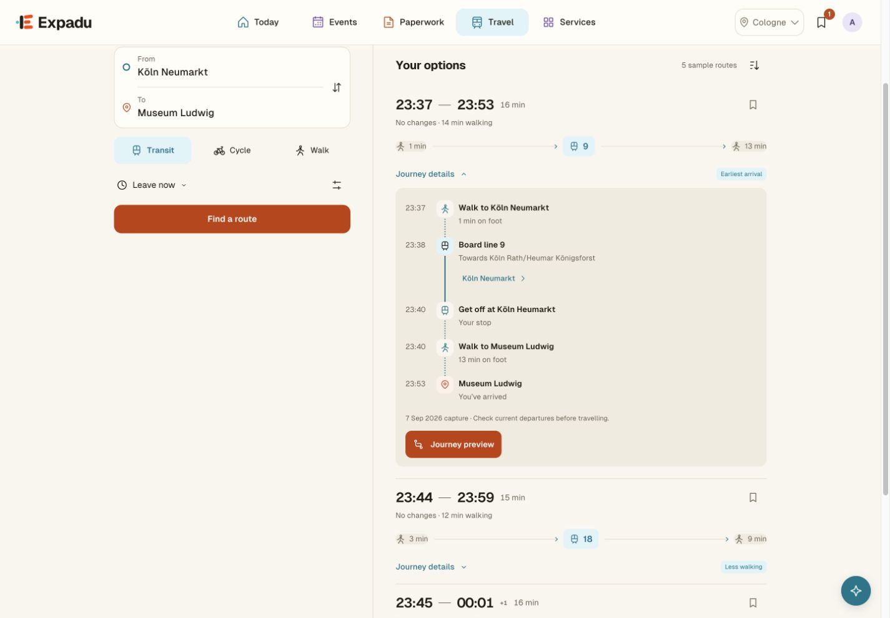
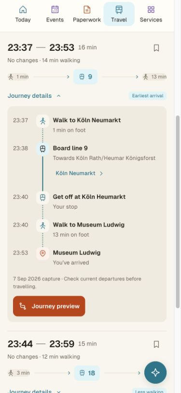
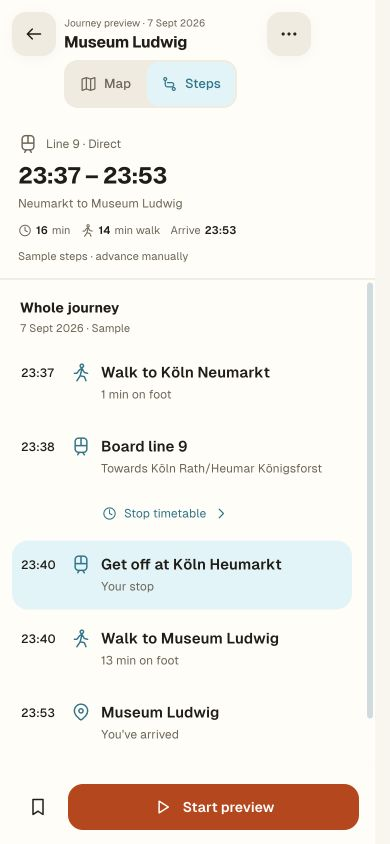

# Travel timetable return correction

5 October 2026. Local Travel prototype only.

The timetable’s Back action always called `selectedRoute`, opening a fresh
journey preview even when the person entered from inline details. Preview-origin
returns also reset inspection state and replaced the original close-focus target.

The return now records its origin. Inline details retain their existing DOM,
expanded route, request, scroll and focus. Preview-origin returns restore the
boarding-adjusted route, inspected step, Map/Steps choice, expansion, itinerary
scroll and original close-focus target without restarting progress. Return
context is consumed once and invalidated by changed requests, new searches,
another preview or planning from a new departure.

## Verification

- Reproduced the original inline-to-modal error in the browser before changing it.
- 385 Travel, connected-flow, Composer and stop-discovery tests pass.
- Added desktop/mobile inline-return, stale-context and preview-state regressions.
- Checked inline round trips at 1440px and 390px: no preview opens; the itinerary
  remains expanded and focus returns to its timetable control.
- Checked a mobile preview round trip: Steps and the inspected alighting step
  remain selected. Closing returns focus to Journey preview, not a hidden button.
- Refreshed the changed asset fingerprints on both Travel entry pages.

